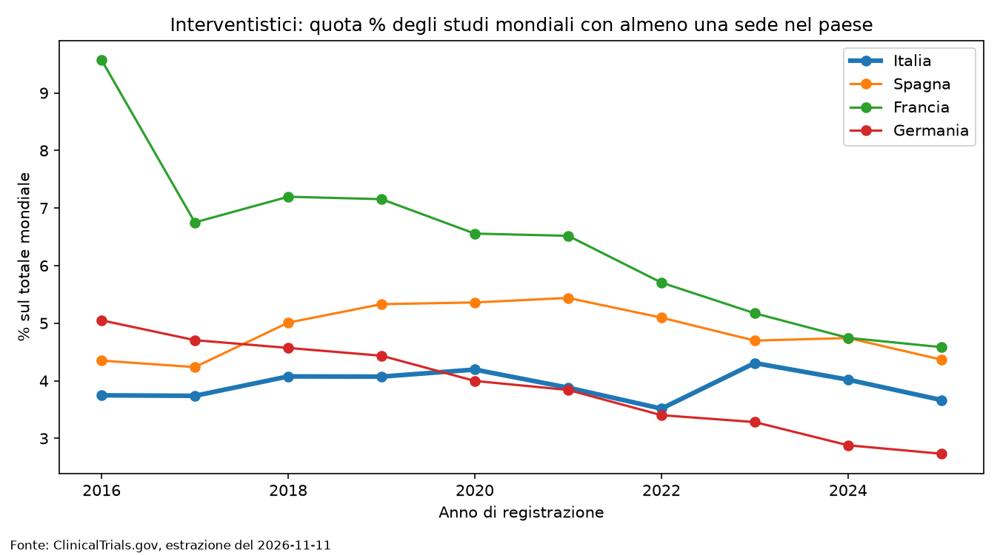

# L'Italia sta perdendo studi clinici? Analisi su ClinicalTrials.gov

Simulazione di un incarico di lavoro su dati reali. La richiesta ("Elena Ferri", direttrice di un'associazione di categoria) è fittizia; i dati e le analisi sono reali.

## La richiesta
> L'Italia sta davvero perdendo studi clinici rispetto a Spagna, Francia e Germania? Da quando e di quanto? Serve un dato difendibile davanti a tecnici del Ministero, con l'indicazione di cosa non è affidabile.

## Risposta in breve


- **Studi interventistici** (la misura più confrontabile tra paesi): l'Italia non perde terreno. La quota sul totale mondiale resta stabile (3,85% → 4,00% tra primo e ultimo triennio). Francia e Germania perdono quota (−14% di studi); Italia e Spagna crescono in linea col mondo (+43%, +40%, contro +39%).
- **Studi osservazionali**: l'Italia sembra crescere del 241%, ma il dato è fuorviante. La quota dei primi 5 sponsor sul totale passa dal 13% (2022) al 38% (2023); tre enti spiegano il 58% dell'aumento 2022-2023.
- La nota consegnata alla "direttrice" è in [`output/nota_elena.md`](output/nota_elena.md).

## Metodo
- **Fonte:** API v2 di ClinicalTrials.gov, estrazione dell'11/11/2026.
- **Periodo:** 2016-2025, per anno di prima registrazione dello studio.
- **"Italia":** studi con almeno una sede di studio in Italia (non lo sponsor). Uno studio con sedi in più paesi compare in ciascuno di essi, quindi le serie dei paesi non si sommano.
- **Termine di confronto:** il totale mondiale degli studi registrati nello stesso anno.
- **Verifica:** il conteggio degli studi interventistici italiani del 2020 (1.105) è stato controllato a mano sul sito ed è uguale a quello dell'estrazione.
- Tutte le scelte e le ipotesi non verificate sono in [`decisioni.md`](decisioni.md).

## Struttura
| File | Cosa fa |
|---|---|
| `codice/01_conteggi_paesi.py` | Scarica i conteggi per paese, anno e tipo di studio |
| `codice/02_analisi.py` | Tabelle, quote sul mondo, indici e grafici per tipo di studio |
| `codice/03_salto_2023.py` | Scarica gli studi osservazionali italiani 2021-2025 con sponsor |
| `codice/04_robustezza.py` | Calcola cosa resta dell'aumento togliendo tre enti |
| `output/` | Tabelle, grafici e nota finale |

## Come eseguirlo
```
pip install -r requirements.txt
python codice/01_conteggi_paesi.py
python codice/02_analisi.py
python codice/03_salto_2023.py
python codice/04_robustezza.py
```
L'API è aggiornata ogni giorno: rieseguendo gli script i numeri potrebbero cambiare leggermente. Per questo i risultati sono datati.

## Limiti
- Non conosco la causa del calo di Francia e Germania; il numero di studi registrati non coincide con l'attività reale di ricerca.
- La registrazione degli studi osservazionali è in genere volontaria: la serie riflette le scelte dei singoli enti.
- Il resto dell'aumento degli osservazionali (oltre i tre enti) è a sua volta concentrato in pochi ospedali; non so dire quanto sia attività reale.
- Non ho filtrato per sponsor italiano: l'API non riporta il paese dello sponsor.

## Uso dell'AI
Il codice è stato scritto con l'aiuto di un assistente AI (Claude Sonnet 5.5 livello medio) a partire da specifiche mie. Le definizioni, la verifica a campione sul sito, la lettura dei risultati e la nota finale sono mie, con revisione critica da parte dell'assistente. Alcune parti del codice (in particolare 01 e 03) non erano state provate sull'API prima di eseguirle.

## Cosa farei diversamente
Applicare la pipeline fin dall'inizio: definire cosa si sta contando, capire chi registra cosa e perché, e scomporre per tipo di studio *prima* di leggere il totale. Ho scoperto il problema degli osservazionali solo dopo una prima lettura sul dato aggregato.
